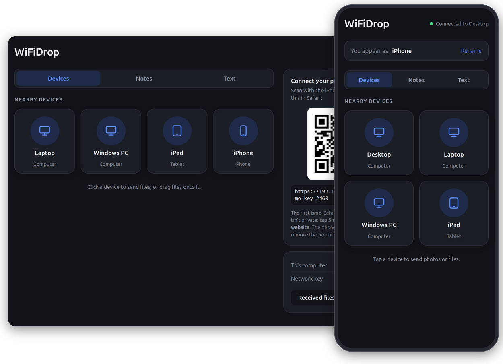
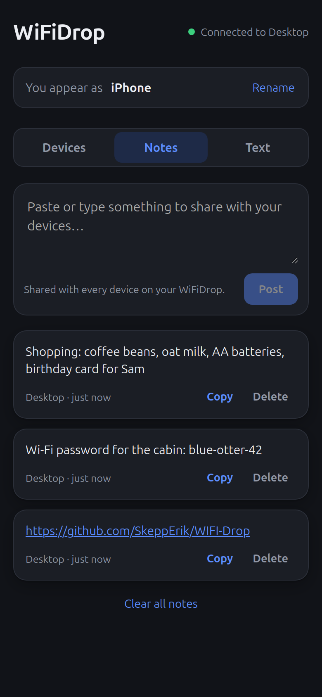
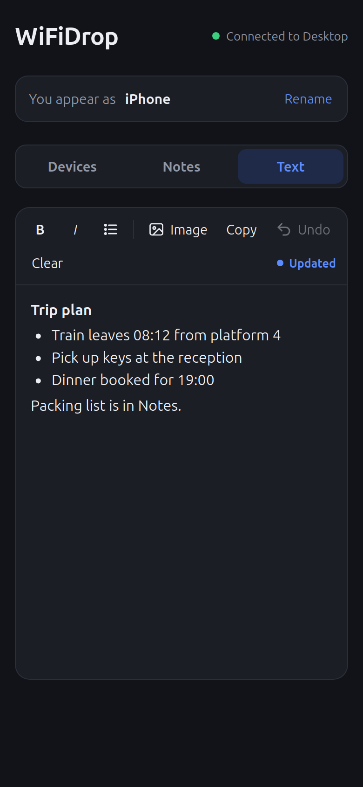
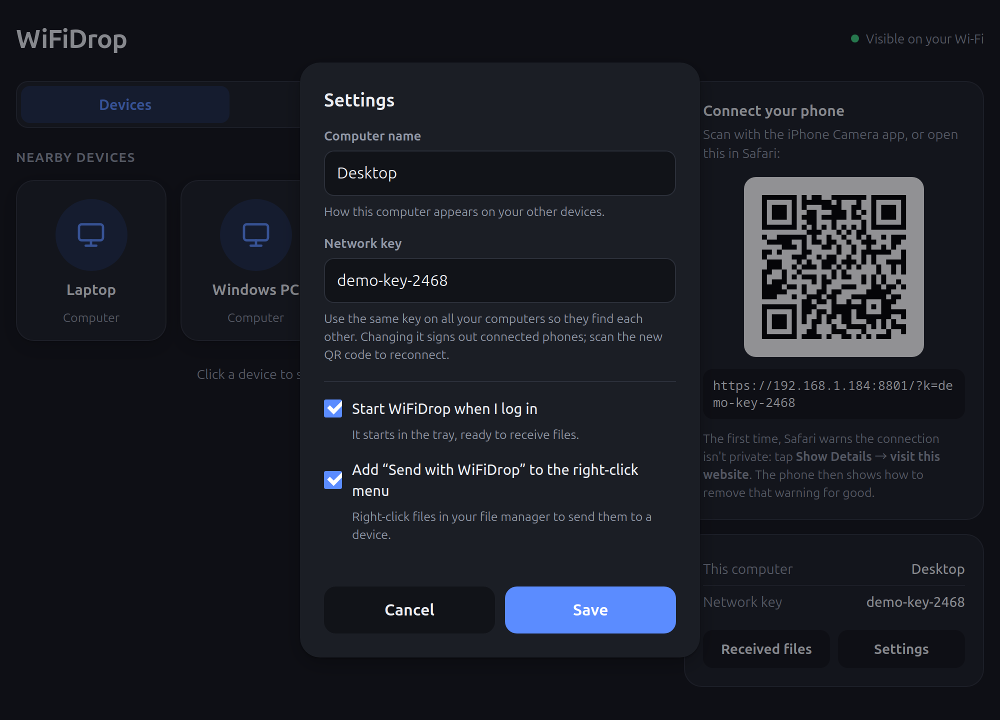
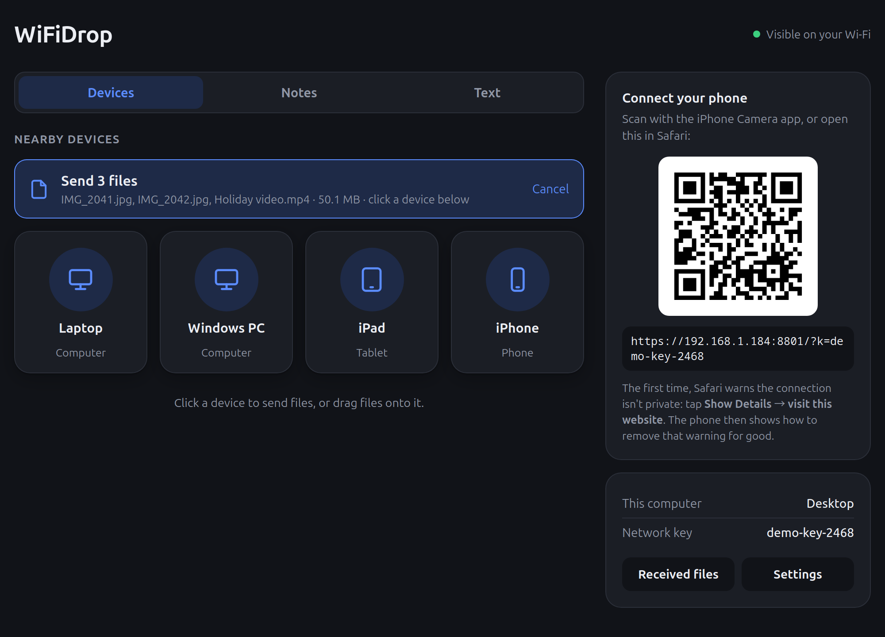

# WiFiDrop

Send files between your devices on the same Wi-Fi, like AirDrop for the gaps AirDrop doesn't cover:
**iPhone ↔ Linux/Windows** and **Linux ↔ Windows**. Nothing leaves your network.

- **Computers** run the WiFiDrop program (a window: `WiFiDrop` on Linux, `WiFiDrop.exe` on Windows).
- **iPhone/iPad** needs no app: scan the QR code in the window, and it opens in Safari.
- Only devices with your **network key** can see or send to you, and everything sent over the network is encrypted (TLS).



## Download

Get the latest version from the **[Releases](../../releases)** page:

- **Linux:** `WiFiDrop`, then make it executable (`chmod +x WiFiDrop`) and run it
- **Windows:** `WiFiDrop.exe`, then double-click it (see [Install](#install) for the first-run warnings)

The downloads are built by GitHub from the code in this repository ([how](#automatic-builds)), and
`SHA256SUMS.txt` lists their checksums.

Or run it from source (Python 3.8+):

```
git clone <this repository's URL>
cd WIFIdrop
pip install -r requirements.txt
python3 app.py
```

## Using it

1. Open **WiFiDrop** on your computer.
2. **iPhone:** point the Camera at the QR code in the window and tap the link. It opens in Safari and stays signed in.
   The first time, Safari warns that the connection isn't private (it doesn't know this computer yet):
   tap **Show Details → visit this website**. The page then offers **Get certificate**: install it once
   (Settings → Profile Downloaded → Install, then Settings → General → About → Certificate Trust Settings →
   switch on WiFiDrop) and the warning is gone for good.
   Tip: Share → *Add to Home Screen* gives it an app icon (install the certificate first, or it won't open).
3. **Other computers:** open WiFiDrop there, go to **Settings**, and enter the **same network key**. Computers then find each other automatically.
4. Click/tap a device to send files, or drag files onto it.

| Sending to | What happens |
|---|---|
| a computer | saved straight to `Downloads/WiFiDrop`, with a notification. Click **Received files** to open the folder |
| an iPhone | the iPhone shows "*X wants to send you…*". **Download** saves it to Files → Downloads |

### Text (a shared page)

The **Text** tab is one page that every device on your WiFiDrop sees and can edit, like a shared notepad.
Type, paste, or drop **images** into it (or tap **Image**; on iPhone that opens your photos). It saves by itself
as you type and shows up on the other devices within a second or two. **B**, *I* and a list button do simple
formatting, **Copy** copies all the text, and tapping an image opens it full size to save it.
**Clear** empties the page on every device; **Undo** steps back one version at a time, including changes made on
other devices (so a page cleared on the phone can be brought back from the computer). The undo history lasts
while the page is open.
Photos are shrunk to 1600 px so they sync quickly; pasted text arrives without fonts or colours from other apps.

If two devices edit at the very same moment, the most recent save wins. Changes from others wait while you're
typing, so the page never jumps under your cursor. The page and its images are kept on every computer
(`pad.json` and `pad-images/` next to the config); images removed from the page are deleted a week later.
Tip: bookmark `…/#text` on the iPhone to open straight on it.

### Notes (shared text snippets)

The **Notes** tab is a shared board for text: paste something on one device, tap **Copy** on another.
On a computer you can just press **Ctrl+V** on the Notes tab to post your clipboard, and **Ctrl+Enter** posts what you typed.
Links in notes are clickable. Notes are kept (up to 200) until someone deletes them, including after a restart,
and every computer with your key keeps an identical copy, so it doesn't matter which one your phone is connected to.
Tip: bookmark `…/#notes` on the iPhone to open straight on the Notes tab.

<p>
  
  
</p>

### Tray icon

WiFiDrop puts an icon in the system tray (Windows notification area; on Linux the panel tray: KDE Plasma, and
GNOME with the *AppIndicator* extension, which Ubuntu has by default). **Closing the window keeps WiFiDrop running
there**, still receiving files: click the icon to open it again, or right-click it for **Received files** and
**Quit WiFiDrop**. Starting WiFiDrop again while it's running also just brings its window back.
If your desktop has no tray, closing the window quits WiFiDrop as before.
On Windows, received files now also show a notification from the tray icon.

### Start at login

**Settings → Start WiFiDrop when I log in** starts it hidden in the tray when you log in, so your phone can
always reach it. (Linux: `~/.config/autostart/wifidrop.desktop`; Windows: the *Run* key in your user registry.)



### Send with WiFiDrop (right-click)

**Settings → Add "Send with WiFiDrop" to the right-click menu** adds it to your file manager. Select files,
right-click, **Send with WiFiDrop**: the WiFiDrop window comes up (starting it if needed) with the files waiting,
and you click the device to send them to.

- **Windows:** Explorer's right-click menu (Windows 11: under **Show more options**).
- **Linux:** Dolphin (KDE) and Nemo show it directly; in Files (Nautilus) it's under **Scripts**.
  The menu entry uses the app's icon once `./install-linux.sh` has installed it.

From a terminal it's `WiFiDrop --send FILE...`. If WiFiDrop or the program file moves, it updates these entries the
next time it starts.



The iPhone page only receives while it's open in Safari.

## Install

**Linux:** put the downloaded `WiFiDrop` in `dist/` (or build it, see below), then `./install-linux.sh` copies `dist/WiFiDrop` to `~/.local/bin` and adds WiFiDrop to your app menu
(`./install-linux.sh --remove` uninstalls). It uses the system's WebKitGTK, which most desktops already have
(otherwise: `sudo apt install gir1.2-webkit2-4.1`).

**Windows:** copy `WiFiDrop.exe` anywhere (e.g. the Desktop) and double-click it. Windows 10/11 already
include the WebView2 component it needs. The first time it runs:
- *SmartScreen* may warn that it's an unrecognized app: **More info → Run anyway** (it's unsigned).
- *Windows Firewall* asks for network access: allow it on **Private networks**.
- If the app window can't start (the WebView2/.NET engine fails), WiFiDrop opens in a Microsoft Edge app window
  instead, or in your browser. What happened is logged to `%APPDATA%\wifidrop\wifidrop.log`.

**Linux firewall** (ufw is on): `sudo ufw allow 8765/tcp && sudo ufw allow 8766/udp`

## Building

| Target | Command | Output |
|---|---|---|
| Linux program | `python3 build.py` | `dist/WiFiDrop` (~10 MB) |
| Windows exe, built on Linux | `./build-windows-wine.sh` | `dist/windows/WiFiDrop.exe` (~12 MB) |
| Windows exe, built on Windows | double-click `build-windows.bat` | `dist\WiFiDrop.exe` |

The Wine build keeps Windows Python in `./.wine`. The script explains the Wine workarounds it needs.

### Automatic builds

GitHub builds both programs on its own machines (`.github/workflows/build.yml`): on every push to `main` and every
pull request (download them from the run's **Artifacts**), and for releases. To publish a release:

```
git tag v1.0.0
git push --tags
```

GitHub then builds `WiFiDrop` (on Ubuntu 22.04, so it runs on that and newer) and `WiFiDrop.exe`, checks
that both start, and creates the release with both files and `SHA256SUMS.txt`. Nothing needs uploading by hand.

To run from source instead: `pip install -r requirements.txt` then `python3 app.py`.
`python3 wifidrop.py` runs it without a window (a terminal/server mode that prints the phone link), and
`WiFiDrop --no-window` does the same from the built program, opening the interface in your browser.

## Options

```
--name NAME          how this computer appears (default: hostname), also changeable in Settings
--key KEY            network key, also changeable in Settings
--port PORT          default 8765
--download-dir DIR   where received files go
--no-window          use the browser instead of an app window
--hidden             start in the tray without a window (used when starting at login)
--send FILE...       hand these files to WiFiDrop and choose a device for them in the window
```

Settings live in `~/.config/wifidrop/config.json` (Windows: `%APPDATA%\wifidrop\config.json`).
Options given on the command line are saved there too. To try things without touching your real settings,
point it at another folder: `WIFIDROP_CONFIG_DIR=/tmp/wd-test python3 app.py`.

## Files

| File | What it is |
|---|---|
| `wifidrop.py` | the core: web server, discovery, transfers (Python standard library only) |
| `certs.py` | creates the TLS certificates (pure Python, standard library only) |
| `app.py` | the desktop program: starts the core and shows it in a window (pywebview), with a tray icon |
| `desktop.py` | tray icon, start at login, right-click menu entries (standard library + GTK's own D-Bus on Linux) |
| `web/` | the interface, shared by the window and the iPhone |
| `wifidrop.spec`, `build.py` | PyInstaller packaging |
| `assets/` | icon (`make_icon.py` regenerates it) |
| `.github/workflows/build.yml` | automatic builds and releases on GitHub |
| `docs/screenshots/` | the pictures in this README |

## How it works

1. **Discovery:** each computer broadcasts a small UDP beacon (port 8766) every 3 s, signed with an HMAC of the
   network key, so only your own computers list each other.
2. **Interface:** the window and the iPhone both load the same web page from the computer and get a live device
   list over Server-Sent Events.
3. **Transfer:** uploads stream over HTTPS (port 8765). Files for another computer are passed straight through to it;
   files for an iPhone wait (up to 30 min) until it taps Download.
4. **Notes:** each computer stores the board in `notes.json` next to its config. A new note is sent to the other
   computers immediately, and each beacon carries a fingerprint of the board, so a computer that was off or missed
   an update notices the difference and syncs within seconds. Deleting a note spreads the same way.
   The shared **Text** page syncs the same way: the newest save wins, and images (stored under their SHA-256)
   are fetched from whichever computer has them, then checked against that hash.

5. **Encryption:** everything on the network uses TLS. Each computer creates its own small certificate authority
   (in `tls/` next to the config) and uses it to issue a certificate for its current IP, renewed automatically when
   the IP changes. The authority is limited to private addresses (192.168.x, 10.x, … and `.local`), so even if its
   key were stolen it couldn't impersonate real websites. Installing it on an iPhone just stops Safari's warning.
   Computers check each other by certificate fingerprint, carried in the signed beacons, before sending anything.
   The window on the computer itself talks plain HTTP over `127.0.0.1`, which never leaves the machine;
   HTTPS and HTTP share port 8765, and plain HTTP from the network is redirected to HTTPS.

## Limitations / ideas

- All your computers need this version: older WiFiDrops without encryption are ignored (the log says so).
- An iPhone sees the computer whose QR code it scanned, plus your other computers. (Phone ↔ phone is left to AirDrop.)
- On Linux the tray icon needs a desktop that shows tray icons (see [Tray icon](#tray-icon)).
- Ideas: send whole folders, resume interrupted transfers, pair computers with a QR code instead of typing the key.
